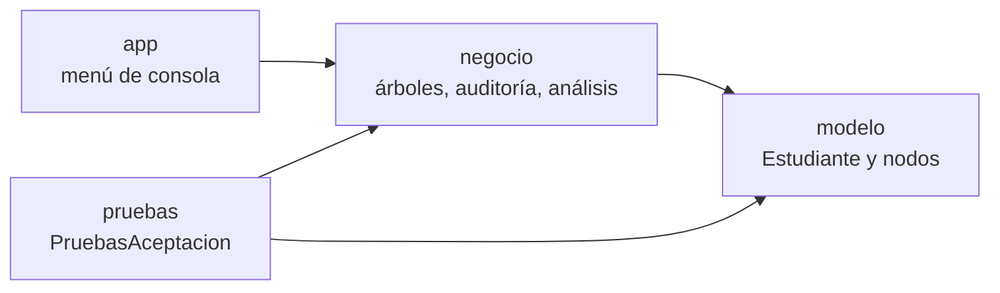
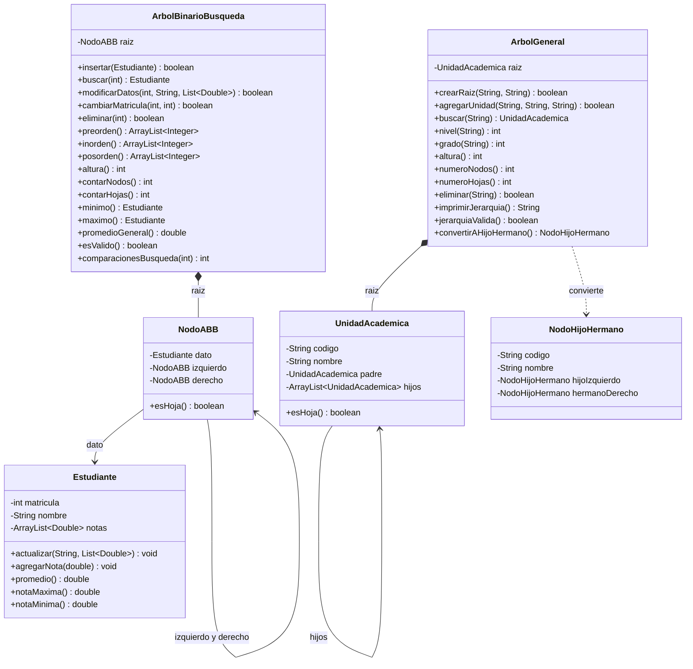
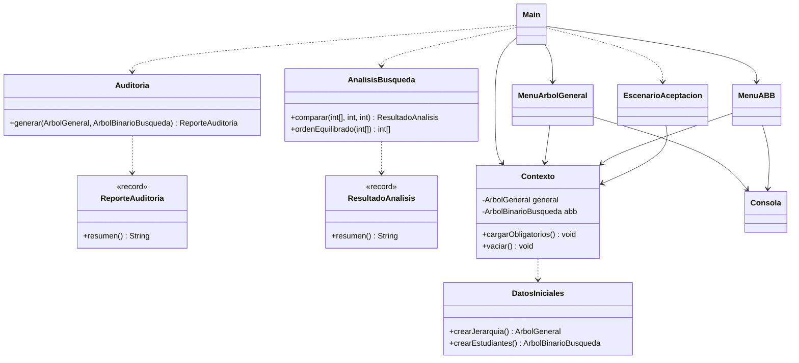
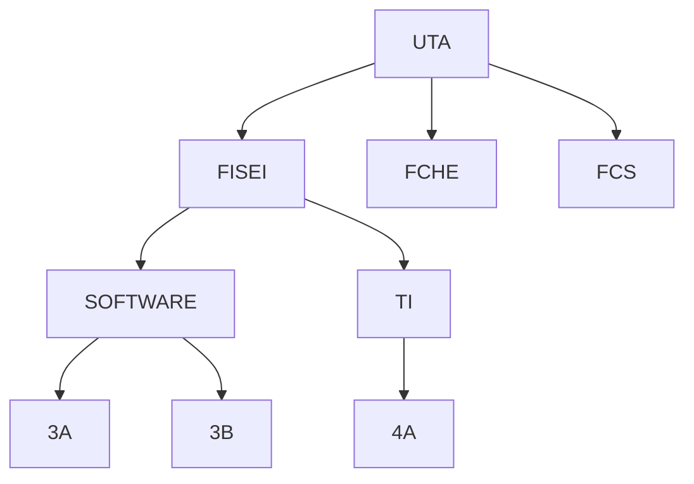
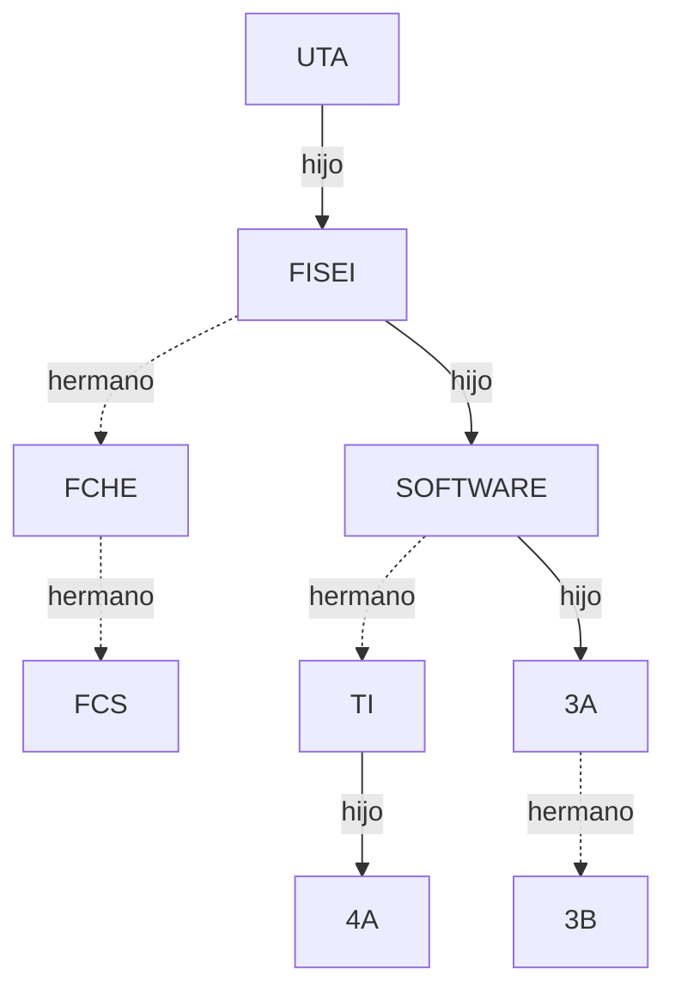
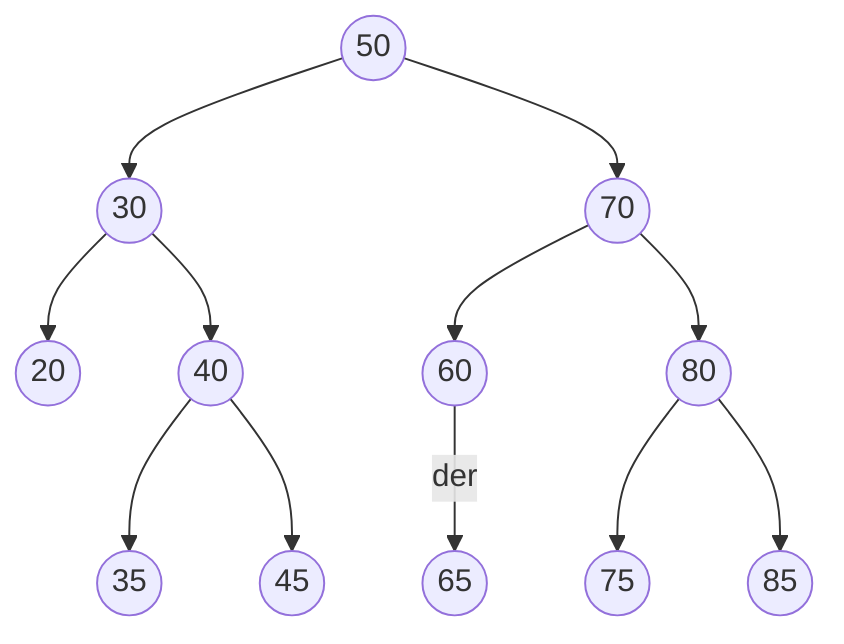
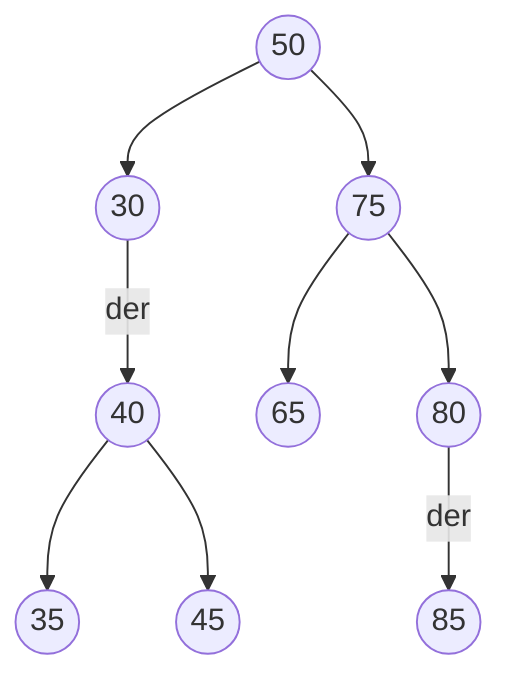
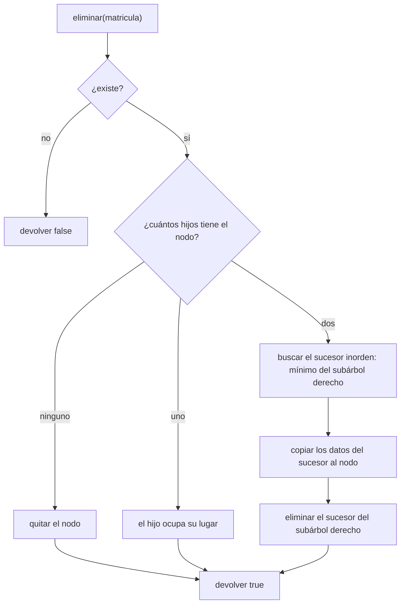
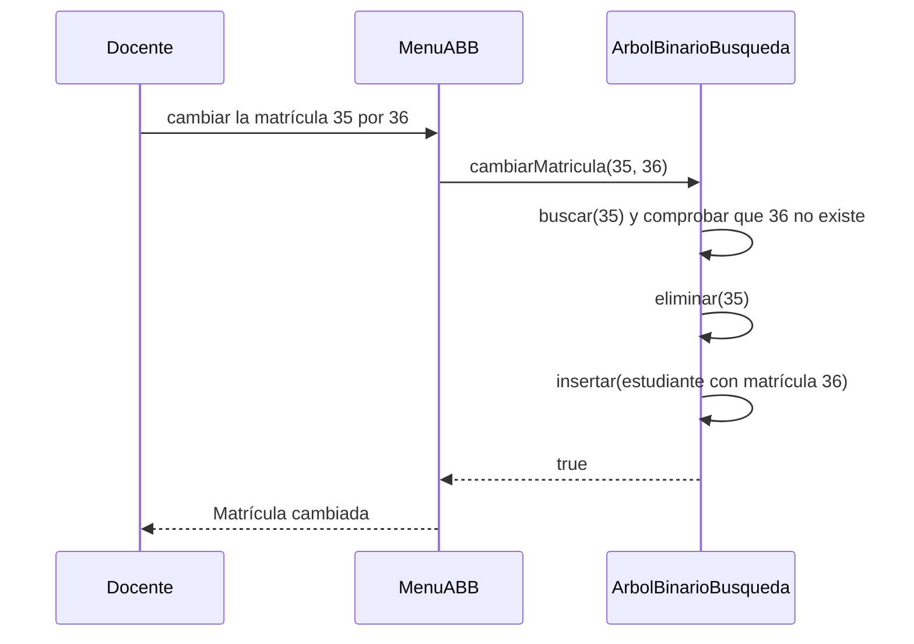

# Sistema de auditoría jerárquica y académica UTA

Prueba práctica grupal de **Estructura de Datos** · UTA · FISEI · Ingeniería de Software · Nivel III.
Árboles en Java (Java 17 o superior, sin librerías externas).

El sistema audita a la vez la jerarquía académica de la Facultad (**árbol general**) y la matrícula de sus estudiantes (**árbol binario de búsqueda, ABB**), con un menú de consola que opera sobre los datos que se tecleen, sin respuestas codificadas.

## Contenido

1. [Integrantes](#integrantes)
2. [El ejercicio](#el-ejercicio)
3. [Estructura del repositorio](#estructura-del-repositorio)
4. [Compilar, ejecutar y probar](#compilar-ejecutar-y-probar)
5. [Menú de consola](#menú-de-consola)
6. [Diseño y decisiones](#diseño-y-decisiones)
7. [Diagramas](#diagramas)
8. [Complejidad](#complejidad)
9. [Cobertura de pruebas](#cobertura-de-pruebas)
10. [Evidencia de ejecución y explicación](#evidencia-de-ejecución-y-explicación)
11. [Capturas de evidencia](#capturas-de-evidencia)
12. [GitHub y colaboración](#github-y-colaboración)
13. [Bibliografía](#bibliografía)

---

## Integrantes

| Integrante | Usuario GitHub | Responsabilidad asignada | Módulo asignado |
|---|---|---|---|
| Chico Yunda Juan Carlos (líder) | juanchicoyunda1234 | Liderazgo, integración final, casos de prueba, README | `negocio.Auditoria`, `negocio.AnalisisBusqueda`, `negocio.DatosIniciales`, `pruebas.PruebasAceptacion` |
| Torosina Armendariz Jeremy | WinoSpop | Documentación y diagramas | Diagramas de clases, sección de estructuras del README |
| Altamirano Segovia Jullisa | jullisaaltamirano2017-boop | Documentación e informe | `docs/evidencia`, evidencia de ejecución |
| Romo Nunez Joseph | wayusa25-cmyk | Backend: modelo | Paquete `modelo` (clases de datos y nodos) |
| Llamuca Abrajan Andres | llamucaandres161 | Backend: negocio | `negocio.ArbolGeneral`, `negocio.ArbolBinarioBusqueda` |
| Tuza Quinatoa Noemi | edithtuza15-collab | Frontend: integración | Paquete `app` (`Main`, menús de consola) |

Los aportes de cada persona se demuestran con sus propios commits y pull requests; ver [GitHub y colaboración](#github-y-colaboración).

---

## El ejercicio

**Caso integrador: Sistema de auditoría jerárquica y académica UTA.** Tiempo sugerido: 150 minutos. Calificación: 2,00 puntos (independiente del cuestionario teórico de 2,00 puntos).

### Situación problemática

La Facultad requiere auditar simultáneamente su jerarquía académica (árbol general) y la matrícula de sus estudiantes (ABB). Actualmente los árboles se administran por separado, existen operaciones incompletas y se han detectado errores relacionados con identificadores duplicados, edición de claves, eliminación con descendientes, alturas incoherentes y falta de evidencias de pruebas. Cada grupo desarrolla desde cero una solución funcional, sin copiar las implementaciones completas de los repositorios de referencia.

### Datos de entrada obligatorios

**Árbol general:** `UTA → FISEI, FCHE, FCS`; `FISEI → SOFTWARE, TI`; `SOFTWARE → 3A, 3B`; `TI → 4A`.
Reglas: los códigos de unidad son únicos; no se admiten ciclos; una unidad no raíz puede eliminarse solo si es hoja; la raíz UTA no puede eliminarse.

**ABB:** insertar en orden las matrículas `50, 30, 70, 20, 40, 60, 80, 35, 45, 65, 75, 85`. Cada matrícula contiene nombre y promedio válido entre 0 y 10. Intentar la duplicada 40; luego modificar nombre y promedio de 35 sin cambiar la matrícula; eliminar 20 (hoja), 60 (un hijo, 65) y 70 (dos hijos, usando el sucesor inorden).

### Funcionalidades exigidas

- **Árbol general:** agregar unidad validando código único y relación padre-hijo; buscar por código; nivel; grado; altura en aristas; número de nodos y hojas; imprimir la jerarquía con sangría; eliminación segura; conversión hijo-izquierdo / hermano-derecho.
- **ABB:** insertar recursivamente, buscar, recorridos preorden, inorden y posorden, modificar sin alterar la clave, eliminar los tres casos, altura, total de nodos, hojas, mínimo, máximo y promedio por estudiante (media aritmética de las notas registradas).
- **Integración:** menú de consola con auditoría que informe total de unidades, hojas, altura general, matrícula menor y mayor, promedio y validez del invariante ABB.
- **Análisis:** contadores de comparaciones para buscar un identificador existente y uno inexistente en dos ABB del mismo tamaño: uno por inserciones ascendentes y otro con inserciones diseñadas para ser más equilibradas.
- **Pruebas automatizadas:** JUnit 5 o un ejecutable de pruebas con aserciones, mínimo 12 casos.
- **GitHub:** ramas feature por integrante, al menos una pull request revisada por otro integrante antes de fusionar, commits sustanciales y README con instrucciones, capturas o salidas y tabla de contribuciones.

### Casos de aceptación verificables

| Prueba / instrucción | Resultado esperado |
|---|---|
| Jerarquía inicial | 9 unidades; hojas FCHE, FCS, 3A, 3B, 4A (5); altura 3; grado de FISEI 2; nivel de 3B 3 |
| ABB tras 12 inserciones | Inorden: 20, 30, 35, 40, 45, 50, 60, 65, 70, 75, 80, 85 |
| Insertar de nuevo 40 | Operación rechazada y conteo preservado (12) |
| Eliminar 20, 60 y 70 | Inorden: 30, 35, 40, 45, 50, 65, 75, 80, 85; 9 nodos |
| Eliminar FISEI con descendencia | Rechazo, jerarquía sin cambios |
| Transformación general a binario | Primer hijo de UTA = FISEI, hermano derecho de FISEI = FCHE, hermano derecho de FCHE = FCS |
| Árboles vacíos y de un nodo | Sin excepciones de referencia nula; altura del vacío -1, de un nodo 0 |
| Búsqueda ABB | Comparar el desempeño O(h) en cadena y balanceado; justificar sin inventar garantías de autoequilibrio |

### Rúbrica (2,00 puntos)

| Criterio | Puntos |
|---|---|
| Árbol general, reglas e integridad | 0,35 |
| ABB completo y correcto | 0,45 |
| Recursión, complejidad y representación | 0,30 |
| Pruebas y casos límite | 0,30 |
| Integración, arquitectura y documentación | 0,25 |
| Colaboración GitHub y defensa individual | 0,35 |

### Condiciones de evaluación

No se permite `TreeMap`, `TreeSet` ni paquetes externos que implementen internamente las operaciones pedidas; `ArrayList` solo para los hijos de un árbol general y los resultados de recorridos. Cada integrante defiende oralmente un método específico, un caso base, una prueba de fallo y la complejidad de búsqueda durante 2 a 3 minutos.

---

## Estructura del repositorio

```
.
├── README.md
├── .gitignore
├── docs/
│   ├── capturas/                 capturas de pantalla de la evidencia (ver sección de capturas)
│   └── evidencia/                salidas reales de la ejecución
│       ├── salida-pruebas.txt
│       ├── salida-escenario.txt
│       └── salida-auditoria.txt
└── src/
    ├── main/java/uta/arboles/
    │   ├── modelo/    Estudiante, NodoABB, UnidadAcademica, NodoHijoHermano
    │   ├── negocio/   ArbolGeneral, ArbolBinarioBusqueda, Auditoria, ReporteAuditoria,
    │   │              AnalisisBusqueda, ResultadoAnalisis, DatosIniciales
    │   └── app/       Main, Consola, Contexto, MenuArbolGeneral, MenuABB, EscenarioAceptacion
    └── test/java/uta/arboles/pruebas/
        └── PruebasAceptacion.java      24 casos con aserciones
```

**Enlaces rápidos**

| Qué | Dónde |
|---|---|
| Menú principal | [`Main.java`](src/main/java/uta/arboles/app/Main.java) |
| Escenario obligatorio completo | [`EscenarioAceptacion.java`](src/main/java/uta/arboles/app/EscenarioAceptacion.java) |
| Árbol general | [`ArbolGeneral.java`](src/main/java/uta/arboles/negocio/ArbolGeneral.java) |
| Árbol binario de búsqueda | [`ArbolBinarioBusqueda.java`](src/main/java/uta/arboles/negocio/ArbolBinarioBusqueda.java) |
| Auditoría | [`Auditoria.java`](src/main/java/uta/arboles/negocio/Auditoria.java) y [`ReporteAuditoria.java`](src/main/java/uta/arboles/negocio/ReporteAuditoria.java) |
| Análisis de búsqueda | [`AnalisisBusqueda.java`](src/main/java/uta/arboles/negocio/AnalisisBusqueda.java) |
| Modelo (datos y nodos) | [`modelo/`](src/main/java/uta/arboles/modelo/) |
| Pruebas automatizadas | [`PruebasAceptacion.java`](src/test/java/uta/arboles/pruebas/PruebasAceptacion.java) |
| Salidas de ejecución | [`docs/evidencia/`](docs/evidencia/) |
| Capturas de evidencia | [`docs/capturas/`](docs/capturas/) |

---

## Compilar, ejecutar y probar

Requisito: [JDK 17 o superior](https://adoptium.net/) (`javac -version`). En Visual Studio Code sirve el [Extension Pack for Java](https://marketplace.visualstudio.com/items?itemName=vscjava.vscode-java-pack). Los comandos se ejecutan desde la carpeta raíz del repositorio.

**Compilar y ejecutar el menú**

```
javac -encoding UTF-8 -d out -sourcepath src/main/java src/main/java/uta/arboles/app/Main.java
java -Dfile.encoding=UTF-8 -Dstdout.encoding=UTF-8 -cp out uta.arboles.app.Main
```

**Compilar y ejecutar las pruebas**

Windows:

```
javac -encoding UTF-8 -cp out -d out-test src/test/java/uta/arboles/pruebas/PruebasAceptacion.java
java -Dfile.encoding=UTF-8 -Dstdout.encoding=UTF-8 -cp "out;out-test" uta.arboles.pruebas.PruebasAceptacion
```

Linux o macOS: cambiar `"out;out-test"` por `out:out-test`.

El ejecutable de pruebas termina con código 1 si falla algún caso. Si los acentos se ven mal en Windows, ejecutar antes `chcp 65001`.

---

## Menú de consola

| Opción | Acción |
|---|---|
| 1 | Árbol general: crear raíz, agregar, buscar, eliminar, renombrar, imprimir con sangría, métricas, conversión hijo izquierdo / hermano derecho |
| 2 | ABB: insertar, buscar, modificar nombre o notas, agregar nota, cambiar matrícula, eliminar, recorridos, listar, métricas |
| 3 | Auditoría: unidades, hojas, altura general, matrícula menor y mayor, promedio y validez del invariante ABB |
| 4 | Análisis de comparaciones de búsqueda entre un ABB en cadena y uno equilibrado |
| 5 | Cargar los datos obligatorios (reinicia ambos árboles) |
| 6 | Ejecutar el escenario obligatorio completo |
| 7 | Vaciar ambos árboles |
| 0 | Salir |

Los datos se pueden cambiar en vivo desde las opciones 1 y 2 y todo resultado se calcula en el momento. Una entrada inválida (texto en lugar de número, nota fuera de rango, código repetido, padre inexistente, árbol vacío) muestra un aviso y vuelve al menú sin excepciones.

---

## Diseño y decisiones

- **Capas:** `app` (menú) usa `negocio` (árboles, auditoría, análisis), que usa `modelo` (datos y nodos). Las pruebas ejercitan `negocio` y `modelo` directamente.
- Altura y nivel se miden en **aristas**: árbol vacío -1, un nodo 0, raíz en nivel 0.
- Una operación rechazada devuelve `false` y deja la estructura sin cambios.
- Los códigos de unidad se normalizan a mayúsculas y sin espacios en los extremos. Son únicos en todo el árbol y, como solo se agregan hojas nuevas, no puede haber ciclos. `jerarquiaValida()` lo comprueba.
- Una unidad no raíz se elimina solo si es hoja. La raíz UTA no se elimina nunca.
- Cada estudiante guarda una lista de **notas individuales** entre 0 y 10. Su promedio es la media aritmética y también tiene nota máxima y mínima. El promedio general es la media de los promedios de los estudiantes.
- La clave del ABB es la matrícula. `modificarDatos` cambia nombre o notas sin tocar la clave. `cambiarMatricula` elimina el nodo y lo inserta con la clave nueva, porque editar la clave en el sitio rompería el orden del árbol.
- La eliminación con dos hijos usa el **sucesor inorden** (mínimo del subárbol derecho): es el menor valor que es mayor que todo el subárbol izquierdo, así el orden se conserva.
- Casos base de la recursión: `altura(null) = -1`, `contarNodos(null) = 0`, `buscar(null) = null`, `insertar` en un hueco crea el nodo.
- El árbol general guarda los hijos en un `ArrayList`, igual que los resultados de recorridos. No se usa `TreeMap`, `TreeSet` ni librerías externas.
- Los dos ABB del análisis tienen las mismas claves. Uno se construye en orden ascendente (cadena) y el otro con un orden de inserción por medianas. Una comparación es un nodo visitado.

---

## Diagramas

### Arquitectura por capas



### Diagrama de clases: modelo y estructuras



### Diagrama de clases: auditoría, análisis y menú



### Árbol general de los datos obligatorios



### Conversión hijo izquierdo / hermano derecho

Línea continua: primer hijo (izquierda). Línea punteada: siguiente hermano (derecha).



La raíz nunca tiene hermano derecho. Cada hermano cuelga del anterior, formando una cadena hacia la derecha.

### ABB tras las 12 inserciones



### ABB tras eliminar 20, 60 y 70

El 20 era hoja, el 60 tenía un hijo (65 ocupa su lugar) y el 70 tenía dos hijos (lo reemplaza su sucesor inorden, el 75).



### Flujo de eliminación en el ABB



### Secuencia: cambiar una matrícula en vivo



---

## Complejidad

| Operación | Costo |
|---|---|
| ABB: insertar, buscar, modificar, eliminar | O(h): O(n) en cadena, O(log n) solo si el árbol está equilibrado |
| ABB: recorridos, altura, conteos, promedio general | O(n) |
| ABB: mínimo y máximo | O(h) |
| Árbol general: buscar, agregar, eliminar | O(n) |
| Árbol general: altura, conteos, impresión, conversión | O(n) |

El ABB **no se autoequilibra**: que la búsqueda sea O(log n) depende del orden de inserción. Con las mismas 12 claves, insertadas en orden ascendente, el árbol es una cadena de altura 11 y buscar el 85 cuesta 12 comparaciones; con un orden por medianas la altura es 3 y cuesta 4.

---

## Cobertura de pruebas

El ejecutable [`PruebasAceptacion`](src/test/java/uta/arboles/pruebas/PruebasAceptacion.java) corre **24 casos** con aserciones propias (sin dependencias externas) y termina con código 1 si alguno falla. Cada requisito de la prueba práctica está cubierto así:

| Requisito | Casos |
|---|---|
| Mínimo 12 casos | 24 |
| Jerarquía válida | 01 |
| Jerarquía inválida | 02 (código duplicado), 03 (padre inexistente y datos vacíos) |
| Padre inexistente | 03 |
| Duplicados | 02 (árbol general), 11 (ABB) |
| Árbol vacío | 05 (árbol general), 16 (ABB) |
| Raíz única | 04 |
| Inorden antes y después de eliminar | 24 (valores exactos), 09 y 13 (antes y después), 15 (ascendente y válido) |
| Eliminación de unidad no hoja | 06 |
| Consistencia del promedio | 18, 23 (y 12 al modificar) |
| Otros casos límite | 07, 08, 10, 14, 17, 19, 20, 21, 22 |

---

